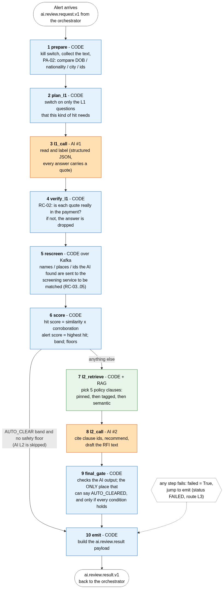

# sanction-ai-service

AI L1 + AI L2 review of held payments for the sanctions-screening POC (synthetic data only). Python 3.12, LangGraph, OpenAI structured output, Qdrant for the policy
clauses. Written to be read by someone new to Python: start with **[docs/PYTHON_NOTES.md](docs/PYTHON_NOTES.md)**.
Spec: `service-skills/sanction-ai-service/SKILL.md` (updated for this simpler design).

> **Screening finds, the AI interprets, code decides.** The model answers a fixed list of questions with labels and word-for-word quotes. Code verifies the quotes,
> re-screens what the AI found, does the scoring, applies the safety floors, and is the only thing that can say "cleared". The model has no field in which to write a score,
> a band or a decision, and no tools.



Orange = the language model, blue = ordinary code, green = RAG. Details: [docs/graph.md](docs/graph.md) (graph) and [docs/RAG_GUIDE.md](docs/RAG_GUIDE.md) (policy retrieval).

## Where it sits
```
orchestrator --ai.review.request.v1--> THIS SERVICE --ai.review.result.v1--> orchestrator
                                          |  ^
              screening.request.v1 (RESCREEN) |  | screening.rescreen.result.v1        sanction-check (Java) matches names / places / ids
                                          v  |
payment.status.v1 / review.status.v1 -> decision memory (earlier decisions on the same party)      audit.events.v1 <- one event per step
```
It always answers: also when it fails (`status: FAILED`), so the orchestrator never waits for nothing. The orchestrator sends every `FAILED` to the human officer.

## Run it: three levels, easiest first

**1. See the whole pipeline on your laptop (no Kafka, MongoDB or API key)**
```
uv sync --extra dev
uv run python scripts/run_sample.py             # NEFT "Mohd Abdul Hafiz": a different person -> AUTO_CLEARED after ONE model call
uv run python scripts/run_sample.py tehran      # MT103 "VIA TEHRAN STREET HUB DUBAI" -> floor G-03 -> AI L2 -> L3 with an RFI draft
uv run python scripts/run_sample.py injection   # near match + "ignore previous instructions" -> L3, security event
```
The default brain is `FakeLLM`: a few text rules that imitate the labels. **It is not AI**; it exists so everything else can run without a key.

**2. Run the tests** (no Docker, no key): `uv run pytest` runs 156 tests (graph scenarios, RAG, checks, 63 injection cases). `uv run pytest -k tc04` runs one.

**3. Run the service with Kafka and MongoDB**
```
docker compose -f ../service-skills/_shared/docker-compose.infra.yml -f docker/docker-compose.yml up --build      # Kafka + Mongo + this service
# or on the host:  cp .env.example .env ; uv run python -m ai_service.main        -> http://localhost:8083/health
uv run --with confluent-kafka python scripts/e2e_inject_payments.py            # end-to-end with the orchestrator and sanction-check running
```

### Switching to the real model
1. In `.env`: `LLM_PROVIDER=openai`, `OPENAI_API_KEY=...`, `OPENAI_MODEL_L1=...`, `OPENAI_MODEL_L2=...`. **No model name is built into the code**: choose and pin them (REVIEW-6).
2. Optionally `EMBEDDER=openai` and `OPENAI_EMBEDDING_MODEL=...`, then `uv run python scripts/ingest_policy.py` (the vector size changes, the collection is rebuilt).
3. Check the plumbing: `RUN_LIVE_LLM=1 uv run pytest tests/e2e/test_live_openai.py -s` (two tiny calls). **This path has not been run against the real API yet** (no key was available when this was built);
   everything else in the service was exercised with the scripted and the demo model.

## Where to look
| I want to understand ... | Open |
|---|---|
| the whole flow of one alert | [docs/graph.md](docs/graph.md), then `src/ai_service/graph/nodes.py` (ten steps in order, each with WHAT / WHY) |
| how the graph is wired | `graph/builder.py` (about 100 lines) |
| the numbers (score, bands, floors, which L1 questions) | `config/*.yml` and `checks/scoring.py` |
| what the AI is asked and allowed to answer | `llm/prompts.py`, `models.py` (L1Output, L2Output) |
| how policy clauses are found | [docs/RAG_GUIDE.md](docs/RAG_GUIDE.md), `src/ai_service/rag/` |
| how Kafka messages are handled | `messaging/service.py` (read top to bottom) |
| the Python idioms | [docs/PYTHON_NOTES.md](docs/PYTHON_NOTES.md) |

```
src/ai_service/
  config.py ids.py logging_setup.py models.py repo.py main.py
  llm/        base.py (interface) prompts.py openai_llm.py fake_llm.py
  rag/        corpus/policy_clauses.json embedder.py store.py ingest.py retriever.py
  checks/     attribute_compare.py evidence.py scoring.py floors.py qa_sampling.py ownership.py     (pure functions)
  graph/      state.py nodes.py builder.py
  messaging/  topics.py producer.py consumers.py rescreen.py service.py
```

## Configuration (`.env`, see `.env.example`)
| Variable | Default | Meaning |
|---|---|---|
| `LLM_PROVIDER` / `EMBEDDER` | `fake` / `hash` | `openai` for the real thing |
| `AI_ENABLED` | `true` | `false` = kill switch: no model call, `FAILED / AI_KILL_SWITCH` (orchestrator applies G-08). Also a `runtime_flags` document `ai_kill_switch` in MongoDB and `ai_kill_switch` in the request |
| `AI_L2_MAY_CLEAR` | `true` | `false`: AI L2 never clears, every L2/L3 band goes to the officer (REVIEW-3) |
| `AI_L2_MAY_CLEAR_FLOOR_L2` | `false` | `false`: a payment with any floor is never cleared by the AI |
| `AI_QA_PERCENT` | from `config/qa.yml` (10) | share of AI clears that also get a QA case (G-10) |
| `AI_MAX_CONCURRENCY` | `4` | alerts processed at the same time |
| `RESCREEN_TIMEOUT_S` | `2` | wait for the screening service; on timeout floor G-07 |
| `KAFKA_BOOTSTRAP`, `MONGO_URI`, `MONGO_DB` | localhost | infrastructure |
| `QDRANT_PATH` / `QDRANT_URL` | `data/qdrant` / empty | embedded vector store, or a Qdrant server |

## Topics and collections
Consumes `ai.review.request.v1` (`ai-svc`), `screening.rescreen.result.v1` (`ai-rescreen-result`), `payment.status.v1` + `review.status.v1` (`ai-decision-memory`),
`sanctions.dataset.activated.v1` (`ai-dataset`). Produces `ai.review.result.v1`, `screening.request.v1` (RESCREEN), `audit.events.v1`, `ai.dlq.v1`.
MongoDB `ai_db`: `ai_runs`, `decision_memory`, `runtime_flags`, `processed_events`.
Audit actions: `AI_REQUEST_RECEIVED, AI_PREPARED, AI_L1_COMPLETED, AI_L1_INVALID, EVIDENCE_DROPPED, RESCREEN_RESULT, AI_SCORED, AI_L2_RETRIEVED, AI_L2_COMPLETED,
AI_GATE_PASSED / AI_GATE_FAILED, AI_RESULT_PUBLISHED, AI_FAILED, QA_SAMPLED, SECURITY_EVENT` (ids, labels, counts: never message text).

## Verified together with the Java services
All three services (orchestrator, sanction-check, this one) on one Kafka + MongoDB with nine mock payments (`scripts/e2e_inject_payments.py`):
`neft_clean` -> RELEASED without AI; "Mohd Abdul Hafiz" -> AI_REVIEW -> **RELEASED** (AI cleared, score 0.15); the injection payment scored **0.94** and went to L3 with G-05
(both exactly the catalogue's numbers); the Tehran-street payment made a real re-screen round trip through the Java service (about 0.85 s) and went to L3 with floor G-03; the rest
went to L3 with floors G-01 / G-02 / G-04. No timeouts.

## Open decisions (REVIEW items of the skill + what I had to decide)
1. **REVIEW-1** score table and cut-offs 0.35 / 0.85 in `config/scoring.yml`: needs the FRD 6.1 table from the BA. The two catalogue examples (0.15, 0.94) pass as tests.
2. **REVIEW-2 / 3** the conditions under which AI L2 may clear are in `final_gate` (`graph/nodes.py`). I added one: **a band-L3 alert is never cleared by the AI**. `AI_L2_MAY_CLEAR=false` turns clearing at L2 off.
3. **REVIEW-5** vector store: Qdrant **embedded** (no container). **REVIEW-6** models: env only. **REVIEW-8** data to OpenAI: masked package, synthetic data only.
4. **REVIEW-9** injection found: the LLM still runs on the quoted text and the route is forced to L3. **REVIEW-10** prior decisions come from `decision_memory` built from `payment.status.v1`.
5. **REVIEW-13** (new) blocking code + threads instead of asyncio, for readability.
6. Deviations from the skill text, all small: three pinned clauses (SCP-2.2, 8.1, 8.2), as in sample 08, not four; L1-01 / L1-05 answers are lists (one entry per hit word);
   RC-06 name-part re-scoring applies to S2-R01 / R02 only (S2-R03 is already aligned by the variant groups); hits of the "other" rules (S2-R05/07/08/09, S1-R05) get a fixed score of 0.30 because
   their floor does the work (`other_hit_score`); the result `event_id` is derived from the request `event_id` so a re-delivered request cannot create a second, different answer;
   re-screen answers are matched by `causation_id`.
7. **Limits to know:** the embedded Qdrant folder can be opened by one process at a time (use `QDRANT_URL` for several instances); the re-screen reader uses the group `ai-rescreen-result`,
   so with several instances an answer may arrive at another instance and time out (floor G-07, safe) until each instance gets its own group; a batch of alerts is committed together after all of them finish.
8. Not done: Prometheus metrics (token usage, latency and timings are in `ai_runs` and the logs), `sanctions.dataset.activated` only refreshes the policy store.
