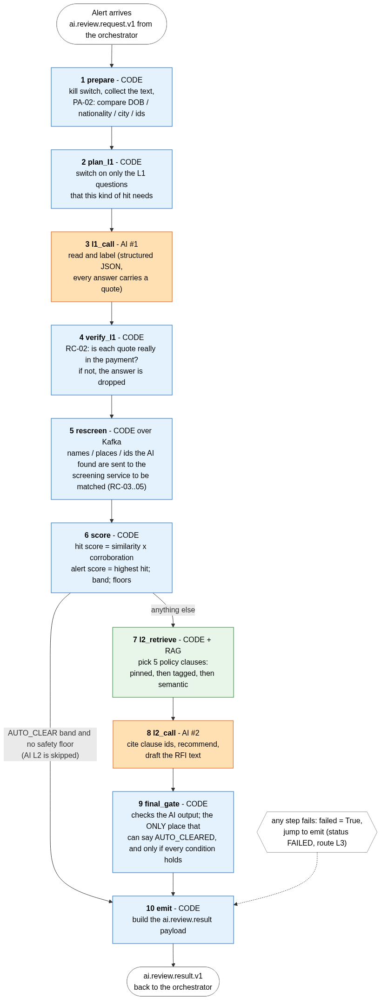

# The LangGraph graph: how one alert flows

*Orange = the language model, blue = ordinary code, green = RAG (policy retrieval). Source of the picture: [graph_overview.mmd](graph_overview.mmd).
The exact machine-drawn version with every edge is [graph.png](graph.png) (made from the code by `scripts/draw_graph.py`).*

## The idea in one sentence
**Screening finds, the AI interprets, code decides.** The model answers a fixed list of questions with labels from fixed lists plus a word-for-word
quote. Code checks the quotes, re-screens what the AI found, does the arithmetic, applies the safety floors and is the only thing that can say "cleared".

## What LangGraph does here (and nothing more)
LangGraph is only the thing that runs the ten steps in order and lets one of them jump to the end when something fails. This project uses five ideas:

| LangGraph idea | Where | Meaning |
|---|---|---|
| `StateGraph(AlertState)` | `graph/builder.py` | a graph whose notebook (state) has the shape `AlertState` (`graph/state.py`) |
| `add_node(name, function)` | `graph/builder.py` | a step. The function takes the notebook and returns **only the keys it changes** |
| `add_edge(a, b)` | `graph/builder.py` | after `a` always run `b` |
| `add_conditional_edges(a, router, {label: node})` | `graph/builder.py` | after `a`, ask `router(state)` for a label and follow it |
| `compile()` / `invoke(state)` | `graph/builder.py` | build it, then run one alert |

No sub-graphs, no checkpointing, no tools, no streaming, no memory: those are not needed and would make it harder to read.

## The ten steps (all in `graph/nodes.py`, in this order)

| # | Step | Who | What it does | Catalogue ids |
|---|---|---|---|---|
| 1 | `prepare` | code | kill switch; collect the payment text; compare DOB / nationality / city / identifiers of the party with the listed person | PA-02 |
| 2 | `plan_l1` | code | switch on only the L1 questions this kind of hit needs (`config/l1_plan.yml`) | trigger matrix |
| 3 | `l1_call` | **AI #1** | read and label; the answer must fit `L1Output`; one retry if the shape is wrong | L1-01..09 |
| 4 | `verify_l1` | code | every quote must be an exact piece of the payment, otherwise that answer is dropped | RC-01, RC-02 |
| 5 | `rescreen` | code (Kafka) | send names / places / ids the AI found to the Java screening service and wait (2 s) | RC-03..05 |
| 6 | `score` | code | hit score, alert score (highest hit), band, floors from the AI's findings | RC-06..09 |
| 7 | `l2_retrieve` | code + RAG | choose 5 policy clauses (pinned, tagged, semantic) and up to 3 earlier decisions | L2-01 input |
| 8 | `l2_call` | **AI #2** | cite clause ids, recommend, draft an RFI text | L2-01..06 |
| 9 | `final_gate` | code | check the AI output; the **only** place that can produce `AUTO_CLEARED`, and only if every condition holds | gate |
| 10 | `emit` | code | build the `ai.review.result` payload; every path ends here | - |

## The two forks
1. **After `score`** (`after_score` in `builder.py`): the score band is `AUTO_CLEAR` **and** no safety floor applies -> `emit` (AI L2 skipped, one model call in total).
   Anything else -> `l2_retrieve`.
2. **After any step** (`continue_or_fail`): if a step set `failed=True`, jump to `emit`, which publishes a `FAILED` result. The orchestrator sends `FAILED` to a human.
   Failures are turned into a state by `guarded()` in `builder.py`: `AI_UNAVAILABLE` (model unreachable), `AI_OUTPUT_INVALID` (wrong shape twice, floor G-06),
   `AI_KILL_SWITCH`, `INVALID_REQUEST`, `AI_INTERNAL_ERROR`.

## Three alerts, three paths

| Alert | Path | Result |
|---|---|---|
| NEFT "Mohd Abdul Hafiz" (listed: "Muhammad Abdul Hafeez") | prepare -> plan -> **l1_call** -> verify -> rescreen -> score (0.15 = 1.00 x 0.15) -> emit | `AUTO_CLEARED`, level L1, one model call |
| MT103 "VIA TEHRAN STREET HUB DUBAI" | ... score (0.30, but floor G-03 lifts the band to L2) -> l2_retrieve -> **l2_call** -> final_gate -> emit | `L3` with an RFI draft |
| pacs.008 near match + "ignore previous instructions" | ... score (0.94, floor G-05) -> l2 ... -> emit | `L3`, security event |

Try them: `uv run python scripts/run_sample.py`, `... tehran`, `... injection`.

## Keeping this picture true
`graph_overview.mmd` is written by hand (so it can be explained), `graph.png` is generated from the code. `tests/unit/test_models_prompts_graph_doc.py`
fails if a node is missing from the overview or a step is no longer connected, so the two cannot silently drift.
After changing the graph run `uv run python scripts/draw_graph.py` (needs internet for the PNGs).
